# DriveMind architecture

DriveMind is an owner-scoped application that prepares read-only Google Drive content for local search and answers questions from that prepared index.

[View interactive architecture →](https://mahad816.github.io/DriveMind_AI/interactive/runtime/)

## Runtime components

| Component | Responsibility |
|-----------|----------------|
| Browser and Next.js | Chat, file browser, settings, and preparation UI. Conversations and their turns are stored server-side in PostgreSQL (the `/conversations` API); the browser keeps only session-scope and preparation-progress state in localStorage. |
| Next.js `/api/v1` rewrite | Forwards same-origin API requests to FastAPI using `BACKEND_URL`. |
| FastAPI | REST routes, Drive authorization callbacks, in-process preparation jobs, RAG orchestration, and citation source lookup. |
| Google Drive | Read-only metadata and content source for sync and ingestion. Normal chat does not fetch Drive content. |
| PostgreSQL | Authoritative records for users/OAuth tokens, sync cursors, Drive metadata and statuses, extracted document text, chunks and full-text vectors, jobs, query history and citations. |
| Qdrant | Vector-search representations of indexed chunks, associated with PostgreSQL chunk UUIDs. It is not the primary text/document store. |
| OpenAI | Embeddings for index build and chat completions for generated answers. |

The frontend calls the FastAPI API through the Next.js rewrite. The backend owns all access to Drive, PostgreSQL, Qdrant, and OpenAI. Local development runs PostgreSQL and Qdrant through `infra/docker-compose.yml`; the diagram does not assume a particular hosted deployment.

## Knowledge preparation

The frontend starts and polls four separate FastAPI jobs: **sync → ingest → chunk → build**. Sync discovers or changes metadata and Drive cursor state; ingest later downloads or exports file content and extracts text; chunk writes searchable PostgreSQL chunk rows; build embeds eligible chunks with OpenAI, reconciles Qdrant points for each file, and marks the file indexed. These jobs execute within the FastAPI process through durable owner-bound admission and a supervised worker with leases and recovery checks. `GET /index/status` reports an optional nullable `sync_available` flag: false means admission is currently unavailable; true is advisory, not a reservation. Missing/null means unknown. Definite admission refusals can be retried explicitly; unknown submission outcomes are never automatically resubmitted.

The preparation queue continues past a failure only when the terminal job positively reports `failure_class: "document"` with coherent file/job evidence. Provider, infrastructure, configuration and unknown failures pause it. Migration `20261125_1200` must precede the new backend.

Full sync takes a Changes API start page token before listing supported files, reconciles missing files after the scan, and persists the token with successful work. Incremental sync consumes a stored token and paginated changes, including removals, trashed files, and newly unsupported MIME types. A failed sync does not advance the successful cursor.

See the [Indexing guide](guides/INDEXING.md) for states and the detailed [sync and indexing diagram](guides/INDEXING.md#drive-sync-and-indexing).

## Question answering

`POST /chat` (the demo UI) and conversation turns (`/conversations/{id}/turns[/stream]`, the normal UI) call `RagService.ask`. On the legacy path a top-level router selects conversation-history recall, chitchat, file inventory, collection summary, named-file lookup, or general grounded RAG. With `TOOL_RAG_AGENT_ENABLED` on (the intended production path), the question goes to the tool-calling agent instead, before any routing (see `docs/TOOL_RAG_ARCHITECTURE.md`); this document otherwise describes the legacy path. Chitchat and inventory do not return document citations. Named-file questions use direct PostgreSQL chunk retrieval. General grounded questions use the linear path by default: Qdrant vector retrieval, plus PostgreSQL keyword and metadata candidates when `HYBRID_RETRIEVAL_ENABLED=true`. `AGENT_GRAPH_ENABLED=true` enables a separate LangGraph retrieval/rewrite path for general grounded questions only.

Grounded evidence is selected within a context budget before OpenAI generation. Citation normalization ties returned references to selected prompt chunks. Query and answer records are persisted in PostgreSQL; `/sources/{chunk_id}` resolves a citation to indexed PostgreSQL text. Chat does not retrieve original content from Google Drive.

See the [Retrieval guide](guides/RETRIEVAL.md) for the [answer-flow diagram](guides/RETRIEVAL.md#question-to-answer) and the [LangGraph guide](guides/LANGGRAPH.md) for graph-specific nodes.

## Supported content

| Type | Extraction |
|------|------------|
| Google Docs | Drive export as DOCX, read like a DOCX (plain-text export only when Google refuses the DOCX export as too large) |
| TXT | Text decode |
| PDF | Text with running headers, footers and bare page numbers removed, pages separated by a form-feed line, and **ruled tables** as Markdown (only when verified against the page text). Tables drawn without lines stay flowing text; scanned PDFs have no OCR fallback |
| Google Slides / PPTX | Slides in order (`## Slide N: title`), bullets, tables, text boxes and **speaker notes** (`Notes:`); footers, date and slide-number placeholders skipped; hidden slides marked. Google Slides are exported as PPTX. Charts, SmartArt and pictures are not read |
| Google Sheets / XLSX | Every visible sheet as `## Sheet: name` plus a Markdown table (first row as header, calculated values). Capped at 1,000 rows and 50 columns per sheet, 5,000 rows and 25 sheets per workbook, with a `Note:` line wherever something was cut. Google Sheets are exported as XLSX (CSV, first sheet only, if the export is too large). Hidden sheets, charts, pivots and number formats are not read |
| CSV | One Markdown table (delimiter detected), same limits and notes as a sheet |
| Markdown | Read as text |
| DOCX | Body in order as light Markdown: headings (`#`), bullets (`- `), tables (`| a | b |` with a header row). Headers, footers, text boxes and images are not read |
| Images | Tesseract OCR |

Drive retains the original files. PostgreSQL retains extracted text and chunks; Qdrant retains vector-search representations.

## API surface

FastAPI mounts the following under `/api/v1`:

| Endpoint | Purpose |
|----------|---------|
| `GET /health`, `GET /health/ready` | Liveness and readiness |
| `POST /auth/session/google`, `GET /auth/session/google/callback` | Owner-bound Google login or read-only Drive connection |
| `GET /auth/session`, `POST /auth/session/logout` | Inspect or revoke the application session |
| `/conversations`, `/conversations/{id}/turns[/stream]` | Owner-scoped persisted conversations and answers |
| `POST /index/sync`, `/index/ingest`, `/index/chunk`, `/index/build` | Separate preparation jobs |
| `GET /index/status`, `GET /index/pending` | Job and pending-work status |
| `GET /files` | Synced metadata across statuses |
| `POST /chat` | Routed answer generation |
| `GET /sources/{chunk_id}` | Indexed chunk text for source viewer |

Evaluation tooling runs from the backend CLI; see the [Evaluation guide](guides/EVALUATION.md).

## Security and scope

Google OAuth authorizes read-only Drive access; application sign-in and sessions are a separate mechanism (`/auth/session/*`), and every private route requires a session principal (or the demo user in demo mode). A fail-closed sign-in allow-list (`GOOGLE_SIGN_IN_ALLOWED_EMAILS`) is the authorization model and is checked at login and on every private request. Every service that acts on a Google credential requires an explicit Owner (KI-031 fixed). Paid Owner questions are limited by a persistent PostgreSQL ledger (20 per hour, 50 per day, 1 concurrent, provisional) on `/chat`, conversation turns and streaming, with input-size caps; normal-mode `POST /chat` requires `Origin` and a CSRF token; the login start is rate-limited and prunes expired states. Residual risks and deferrals (running turns and queued jobs of a removed address, deployment-only checks) are listed in `docs/specs/m0-sec-security-hardening.md` and gated by M9 in the v1 spec; the M0 audit, `docs/audits/m0-system-audit.md`, is a dated snapshot. Provider credentials belong in environment variables, never repository files. The backend reads Drive during sync/ingestion and uses the local index for normal answers.

For setup and deployment considerations, see [Local Setup](guides/SETUP.md) and [Deployment](guides/DEPLOYMENT.md).
