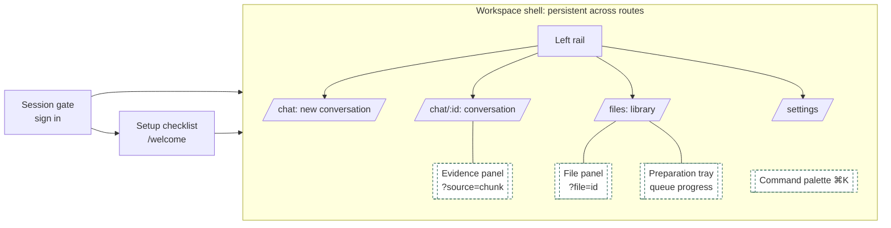
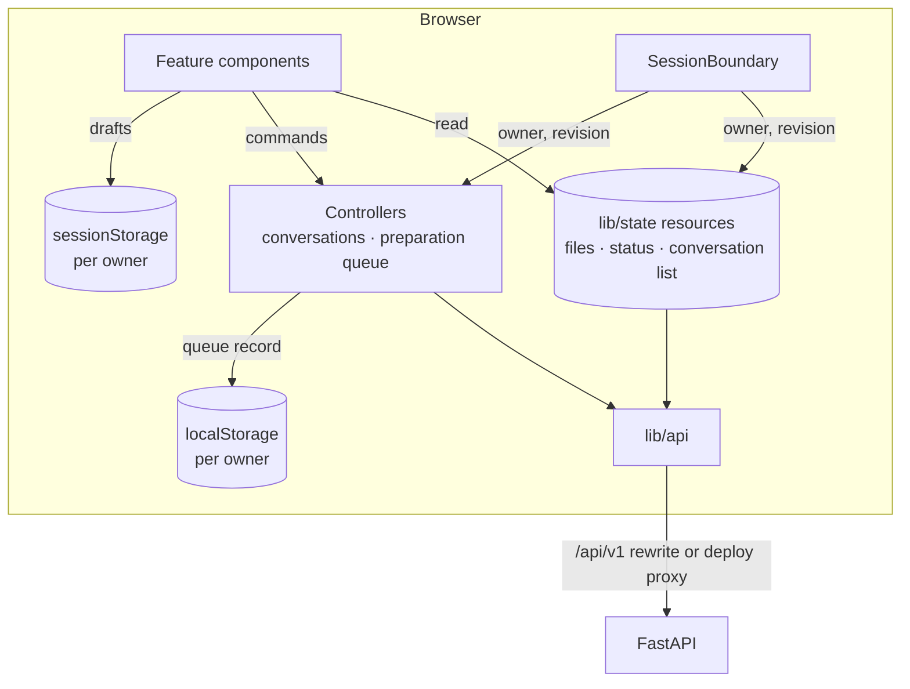

# DriveMind redesign blueprint (Phase 1)

Date: 2026-11-25. Author: Claude Code (Opus 5.5), acting as product designer and frontend architect.
Status: **proposal, awaiting Phase 2 authorization.** Nothing in this document is implemented. No branch, worktree,
stash, commit or product-code change was made to produce it.

**Public repository.** No real Drive file name, account, e-mail or document text appears here. Example content is
fictional.

## 0. How to read this document

Evidence labels, used wherever a claim about today's product is made:

| Label | Meaning |
|---|---|
| CODE | Read in source at HEAD `45a3f0c` (committed) unless marked "pending" (uncommitted working tree) |
| LIVE-THIS | Observed in a browser in this session |
| LIVE-AUDIT | Observed live in `docs/audits/product-ux-audit.md` (same day, same HEAD, untracked file) |
| TEST | Covered by an existing test |
| PROPOSAL | New design, not built |

**Live-inspection limitation (important).** In this session the local backend (`uvicorn` on `127.0.0.1:8000`, running
about four hours) accepted connections but answered nothing: `GET /api/v1/health` dropped after about 8 s, and
`GET /auth/session` through the frontend proxy returned 500 after 8 s. The `drivemind-qdrant` container reported
`unhealthy`. I did not restart your server (the brief says not to touch it). The only page I could observe live was
the session gate: "Checking your sign-in…" for about 8 s, then "Sign-in is temporarily unavailable. Please try again."
with "Verify session again" (LIVE-THIS). Every signed-in observation below therefore comes from code and from the
same-day audit, labelled as such. **Phase 2 step 0 repeats the live walkthrough** once the backend is healthy.

---

## 1. Product understanding

DriveMind is a private research assistant over one person's Google Drive. Its promise is **trustworthy answers you can
check**: every grounded answer cites the exact passage it came from, and the passage opens in one click.

The product has three verbs, in this order:

1. **Connect**: sign in with Google (session), then grant read-only Drive access (separate consent).
2. **Prepare**: DriveMind discovers file names (sync), and the person chooses which documents to make searchable
   (ingest → chunk → build). Discovery and preparation are deliberately separate, and preparation is deliberate
   (at most five documents per batch, one explicit confirmation per document).
3. **Ask**: conversations answer questions from prepared documents only, with citations.

Who uses it: a single knowledgeable person (student, researcher, consultant) with hundreds of Drive files, a few dozen
of which matter at any moment. They care about provenance more than speed, and they return to past conversations.

What it is **not** (CODE): it does not edit Drive, it does not search Drive live during chat, it has no Gmail, no
sharing or teams, no full-text document search outside chat, and no full-document reader for prepared files.

Design consequence: the hero of the product is **the answer with its evidence beside it**, not a dashboard. The
library exists to feed the conversation; settings exist to be ignored.

---

## 2. Existing functionality inventory

| # | Capability | State | Evidence | Notes for the redesign |
|---|---|---|---|---|
| 1 | Google sign-in (application session, HttpOnly cookie, CSRF token from `GET /auth/session`) | Operational | CODE | Gate lives in `ApplicationSessionProvider`. Sign-in returns to `/settings?login=success` (backend redirect, fixed) |
| 2 | Sign-in allow-list, 7-day sessions, logout (`POST /auth/session/logout`) | Operational | CODE, `AGENTS.md` | Not my concern in UI beyond clear copy |
| 3 | Connect Google Drive (`POST /auth/session/google` intent `CONNECT_DRIVE`) | Operational | CODE | Separate consent from sign-in |
| 4 | Disconnect Drive | **No endpoint.** Only a link to Google Account permissions ("Manage Google access") | CODE | Do not design a "Disconnect" button that pretends to work |
| 5 | Drive sync / discovery (`POST /index/sync`, `GET /index/status`) | Operational | CODE, LIVE-AUDIT | Pending: `sync_available` and typed rejection reasons |
| 6 | File inventory (`GET /files`, whole list, no paging or server search) | Operational | CODE | All filtering, sorting, searching is client-side over the full list (516 files in the audit) |
| 7 | Per-file preparation (`POST /index/ingest|chunk|build` with file id, 202 + job id) | Operational, tested | CODE, TEST | Queue logic in `lib/knowledge/preparation-queue*.ts`, heavily guarded |
| 8 | Batch queue (max 5, confirm each next document) | Operational; stops on any failure | CODE, TEST | Pending Checkpoint A changes this (continue past a document failure); **its final review is BLOCK** |
| 9 | Failure class on jobs (`failure_class`) | **Pending, uncommitted** | CODE (pending) | Needed for "continue past failure" UX |
| 10 | Retry of failed or skipped documents | Not available (eligibility rejects them) | CODE | Owner decision still open (audit Q-02) |
| 11 | Cancel a running preparation | Not available | CODE | Do not show a Cancel button for jobs. "End" only removes local queue state (pending) |
| 12 | File preview | Metadata always; text preview only for `text/*`, JSON, XML via live `GET /files/{id}/content`; "Open in Google Drive" link | CODE | No text preview for Docs, PDF, Sheets, Slides. No chunk-by-file endpoint |
| 13 | Conversations: create, list (cursor, 30 per page, max 100), open (50 turns, `before_sequence`), rename, delete (optimistic version) | Operational | CODE | Create is idempotent by `create_request_id` |
| 14 | Ask (turn submit, idempotent `client_request_id`, `expected_content_version`) | Operational | CODE | Paid call. Quota: 429 + `Retry-After`; 503 if ledger unusable |
| 15 | Streaming (`/turns/stream`, SSE events `accepted`, `state{searching|validating}`, `provisional{text}`, `complete|receipt|error`) | Operational, **off by default** (`NEXT_PUBLIC_CHAT_STREAMING_ENABLED`) | CODE | Design must look right in both modes |
| 16 | Turn recovery: status poll, interrupt expired turn, outcome-unknown handling | Operational | CODE | The controller refuses to resubmit an unknown outcome. Keep this |
| 17 | Stop | Client-side abort only ("Stop" / "Stop waiting"); server generation may continue | CODE | Copy must say so |
| 18 | Regenerate | **Demo mode only**; server chat has no regenerate | CODE | Remove from normal UI |
| 19 | Citations: chunk id, file name, snippet, score; source viewer `GET /sources/{chunk_id}` | Operational | CODE | Source text is one chunk, not the whole document |
| 20 | Conversation search | Client-side title filter over loaded pages only | CODE | No server search |
| 21 | Global document search | **Does not exist** | CODE | Only file-name search and chat retrieval |
| 22 | Gmail | **Does not exist** (no code, no docs mention) | CODE (grep) | Design an integrations slot, never a fake connection |
| 23 | Appearance (System, Light, Dark) via `next-themes` | Operational; pending default Light | CODE | |
| 24 | Onboarding (four steps) | Operational, state partly wrong (audit L-02) | LIVE-AUDIT | Replace with a state-driven setup checklist |
| 25 | Demo mode (`NEXT_PUBLIC_DEMO_MODE`, fictional sample corpus, anonymous `/chat`) | Operational | CODE | Out of scope for the rebuild's first release; keep the flag working or retire it explicitly (decision D9) |

---

## 3. Current architecture and API map

### 3.1 Frontend today

```
app/layout.tsx  (root, client providers)
  ThemeProvider → ToastProvider → TooltipProvider
    ApplicationSessionProvider   ← gate: renders children ONLY when status = "ready"
      ConnectionStatusProvider   ← shared /index/status source, interval polling
        ServerConversationsProvider ← conversation controller (list, detail, submit)
          AppShell (sidebar + main)
            routes: /, /chat, /chat/[id], /files, /index→/files, /prepare,
                    /onboarding, /settings, /sources/[chunkId], not-found
```

- Next.js 15.5 App Router, React 19, Tailwind 4, Base UI, lucide, react-markdown + remark-gfm, next-themes. Vitest +
  Testing Library (876 tests at the last record). (CODE)
- No `loading.tsx` or `error.tsx` route files. No `router.refresh()` anywhere. No React Query or SWR. (CODE)
- State lives in hand-written controllers with owner and revision fencing (`lib/api/session-events.ts`), plus
  `localStorage` for queue records, discovery state, onboarding flags, last prepared date. (CODE)
- Production: `frontend/Dockerfile` copies **`app`, `components`, `lib`, `public`** and config, runs
  `deploy/server.mjs` with `deploy/api-proxy.mjs` for `/api/v1`. (CODE) **The new frontend must keep these four
  top-level folders** or the Dockerfile must change (it should not need to).

### 3.2 Backend contract the frontend uses (all under `/api/v1`)

| Area | Method and path | Request | Response / notes |
|---|---|---|---|
| Session | `GET /auth/session` | – | `{kind:"GOOGLE_ACCOUNT", user_id, csrf_token}`; 401 when signed out |
| | `POST /auth/session/google` | header `X-DriveMind-Auth: 1`, `{intent: LOGIN|CONNECT_DRIVE}` (+CSRF for connect) | `{authorization_url}` (must be `https://accounts.google.com`) |
| | `GET /auth/session/google/callback` | Google redirect | 302 to `<frontend>/settings?login=success` |
| | `POST /auth/session/logout` | CSRF | 2xx |
| Health | `GET /health`, `/health/ready`, `/health/indexing` | – | diagnostics, not product UI |
| Drive status | `GET /index/status[?job_id=]` | – | `{connected, job, sync_available?(pending), demo_*}` |
| Sync | `POST /index/sync` | CSRF | 202 `{job_id, status:"queued"}`; 409 unresolved job; 503 executor unavailable / not connected |
| Prepare | `POST /index/ingest|chunk|build?file_id=` | CSRF | 202 job; same rejections |
| Pending | `GET /index/pending` | – | counts per stage |
| Files | `GET /files` | – | `{files: DriveFileRead[], total}` (all rows) |
| | `GET /files/{id}/content` | – | raw bytes, live from Drive; 404, 415, 502, 503 |
| Conversations | `POST /conversations` | `{create_request_id, title?}` | 201 new / 200 replay |
| | `GET /conversations?limit&cursor` | – | `{conversations[], next_cursor}` |
| | `GET /conversations/{id}?limit&before_sequence` | – | `{conversation, turns[], next_before_sequence}` |
| | `PATCH /conversations/{id}` | `{title, expected_metadata_version}` | updated row; 409 on stale version |
| | `DELETE /conversations/{id}` | `{expected_metadata_version}` | 204 |
| Turns | `POST /conversations/{id}/turns` | `{client_request_id, question ≤4000, expected_content_version}` | 200/202 receipt; 429 quota with `Retry-After`; 503 |
| | `POST /conversations/{id}/turns/stream` | same, `Accept: text/event-stream` | SSE as in row 15 above |
| | `GET /conversations/{id}/turns/{turn_id}` | – | turn status + `execution_expired` |
| | `POST /conversations/{id}/turns/{turn_id}/interrupt` | – | turn status |
| Sources | `GET /sources/{chunk_id}` | – | `{chunk_id, drive_file_id, filename, mime_type, chunk_index, text, modified_at}` |
| Legacy | `POST /chat` | – | demo UI endpoint; normal UI uses conversation turns |

Turn states: `RUNNING`, `COMPLETED` (answer + ≤64 citations), `FAILED` (`TURN_FAILED`), `INTERRUPTED`
(`TURN_INTERRUPTED`). File states: `discovered`, `indexing`, `indexed`, `failed`, `skipped`. Job states: `queued`,
`running`, `completed`, `failed`, `canceled`. (CODE)

### 3.3 Reuse decision

| Keep unchanged in the new frontend (contract and safety logic, heavily tested) | Rebuild |
|---|---|
| `lib/api/*` (client, CSRF, session fencing, stream parser, strict DTO validation) | All of `app/` pages and layouts |
| `lib/conversations/server-controller.ts` (idempotent submit, unknown-outcome rules) | All of `components/` |
| `lib/knowledge/preparation-queue*.ts`, `discovery.ts`, `joined-check.ts`, `single-file-preparation.ts` (after Checkpoint A lands) | `app/globals.css`, tokens, fonts |
| `lib/chat/citations.ts`, `source-label.ts`, `question.ts` | `lib/hooks/*`, `lib/navigation.ts`, `lib/user-language.ts` (copy rewritten) |
| | `lib/onboarding/*`, `lib/settings/*` (replaced by state-driven setup) |

Rationale: the brief says to reuse contracts and genuinely useful utilities. These `lib` modules *are* the contract
plus hard-won safety rules (owner fencing, no blind resubmission, compare-and-set queue writes). Rewriting them would
reopen solved bugs for no user-visible gain. They have no visual code, so they do not carry the old design with them.

---

## 4. Proposed information architecture

### 4.1 Principle

One place to **ask** (the conversation), one place to **choose what DriveMind knows** (the library), one place for
**rarely-touched configuration** (settings). Everything else is a panel, a palette or a contextual menu.

### 4.2 Map



### 4.3 Where each capability lives

| Capability (brief list) | Location | Why |
|---|---|---|
| 1 Home / workspace | `/` resolves: not set up → `/welcome`; set up → `/chat` | The workspace *is* a new conversation with a knowledge summary. A separate dashboard would be decoration |
| 2 New chat | Rail top button + `⌘K → New chat` + `Shift+⌘O` | Most common action |
| 3 History | Rail list, grouped Today / Previous 7 days / Older, with rename/delete in a row menu | Always visible on desktop, a drawer on mobile |
| 4 Global search | Command palette (`⌘K`, `/` on empty focus): files by name, conversations by title, actions, "Ask about …" | No content-search endpoint exists. The palette is honest about scope (see 6.4) |
| 5 File library | `/files` | One page with views and a detail panel |
| 6 Document preview | File panel on `/files?file=<id>` and from citations | Metadata, text preview where supported, Open in Drive |
| 7 Preparation | Selection on `/files`, review in a sheet, progress in a **preparation tray** docked bottom-right that follows you across routes | You can keep chatting while it runs, but you see it |
| 8 Results and citations | Inline numbered markers in the answer + the evidence margin | The defining element |
| 9 Chat and research | `/chat/:id` | Core |
| 10 Integrations and account | `/settings` (Account, Integrations, Appearance, About) | Rarely used |

**Not in the main navigation:** preparation (contextual), onboarding (shown only until complete), source viewer page
(kept at `/sources/[chunkId]` for deep links and narrow screens, but normally a panel), diagnostics (removed from
primary UI; `/health/*` stays a backend concern).

### 4.4 Rail (left, 248 px, collapsible to 56 px)

```
┌──────────────────────────┐
│ DriveMind            [‹] │  wordmark; collapse
│ [ + New chat      ⇧⌘O ]  │  primary
│ ( Search…          ⌘K )  │  opens palette (not an inline field)
│                          │
│ Today                    │
│   Thesis outline gaps  ⋯ │  ⋯ = Rename, Delete
│   Budget sheet totals    │
│ Previous 7 days          │
│   …                      │
│   Load older             │  only when next_cursor
│ ──────────────────────── │
│ ▤ Library        42 ready│  count = indexed files
│ ⚙ Settings               │
│ ● Drive connected        │  status line; click → Settings › Integrations
└──────────────────────────┘
```

No top navigation bar on desktop: the page title sits in the content column. A slim top bar appears only below 768 px
(menu, title, new chat).

### 4.5 Routes

All existing paths are kept so bookmarks and the backend redirect keep working.

| Path | New role |
|---|---|
| `/` | Resolver (no visible page; at most a 1-frame skeleton of the shell) |
| `/welcome` (new) and `/onboarding` (redirect to `/welcome`) | Setup checklist |
| `/chat` | New conversation canvas (no conversation created until first send) |
| `/chat/[id]` | Conversation; `?source=<chunkId>` opens the evidence panel |
| `/files` | Library; `?view=ready|todo|attention|all&q=&sort=&file=<id>` all in the URL |
| `/prepare`, `/index` | Redirect to `/files` with the tray open |
| `/settings` | Sections; `?login=success` handled here (backend fixed target) then routes onward |
| `/sources/[chunkId]` | Full-page evidence view (mobile, deep links) |

---

## 5. Navigation and page structure

### 5.1 Conversation (`/chat/[id]`), desktop ≥1280 px

```
┌ rail ┬───────────────────────────── conversation ────────────────────┬── evidence margin ──┐
│      │  Thesis outline gaps                         [⋯]               │                      │
│      │                                                               │  ① Chapter-3-notes   │
│      │  You ─ What does chapter 3 still need?                         │  “…the sampling      │
│      │                                                               │  section lacks a     │
│      │  DriveMind                                                     │  justification…”     │
│      │  Chapter 3 is missing a justification for the sampling         │  Open passage        │
│      │  method ①, and the results section has no limitations          │                      │
│      │  paragraph ②.                                                  │  ② Supervisor-       │
│      │  ─ Copy · 2 sources                                            │  feedback            │
│      │                                                               │  “…add limitations…” │
│      │                                                               │                      │
│      │ ┌───────────────────────────────────────────────────────────┐ │                      │
│      │ │ Ask about your prepared documents…                   [↑]  │ │                      │
│      │ └──── 42 documents ready · Answers cite their sources ──────┘ │                      │
└──────┴───────────────────────────────────────────────────────────────┴──────────────────────┘
```

- Reading column max 68 ch (about 680 px at 17 px serif). Left-aligned. Messages are not bubbles: a question is a
  quiet sans line with a hairline left rule; an answer is serif prose.
- **Evidence margin** (320 px): one note per cited passage, numbered in citation order, vertically placed next to the
  answer that cites it (sticky within that answer). Hovering or focusing marker ① highlights note ① and vice versa.
  Clicking "Open passage" expands the note in place to the full chunk text from `/sources/{chunk_id}`, with the cited
  snippet marked with the highlighter colour, plus "Open in Google Drive" and "Show file details".
- 1024–1279 px: the margin collapses to a toggle; notes open as a right sheet (400 px) over the column.
- <768 px: markers open a bottom sheet; "Open passage" goes to `/sources/[chunkId]?conversation=<id>`.

### 5.2 New conversation (`/chat`)

```
  What do you want to find in your documents?        (serif, 28 px, left-aligned in the column)
  42 documents are ready. Answers only use these.    [Manage library]

  ┌──────────────────────────────────────────────────────────┐
  │ Ask a question…                                     [↑]  │
  └──────────────────────────────────────────────────────────┘
  Recently prepared:  Chapter-3-notes  ·  Budget-2026  ·  Supervisor-feedback      (chips insert "In <file>, …")
```

If zero documents are ready, the composer is replaced by a single task: "Prepare documents to start asking" →
`/files?view=todo`. No suggestion chips that send paid questions on click; chips only insert text.

### 5.3 Library (`/files`)

```
  Library                                                  [Check Drive for changes]
  Choose which documents DriveMind can read. Your Drive is never changed.

  [ Ready 42 ][ To prepare 470 ][ Needs attention 4 ][ All 516 ]     ( Filter by name… )  Sort: Modified ▾
  ┌──┬─────────────────────────────────┬──────────────┬────────────┬──────────┐
  │☐ │ Chapter-3-notes  · Docs          │ Thesis/Drafts │ 2 days ago │ ● Ready  │
  │☐ │ Budget-2026      · Sheets        │ Finance       │ Nov 12     │ ○ To prep│
  └──┴─────────────────────────────────┴──────────────┴────────────┴──────────┘
  ‹ 1 2 3 … ›                                        selection bar slides up when ≥1 selected:
                                          ┌─────────────────────────────────────────────────────┐
                                          │ 3 of 5 selected · [Clear]          [Review and prepare]│
                                          └─────────────────────────────────────────────────────┘
```

- Views sum to the total ("Needs attention" = `failed` + `skipped`; fixes audit F-06).
- Filter matches across all views with `_`, `-`, `.` treated as spaces (fixes F-03) and shows "Showing matches in All"
  when it widens scope.
- Row click opens the file panel (right, 420 px); checkbox selects. Selection survives view changes, refetches and tab
  switches (fixes F-01).
- Paging: 50 rows per page, virtualisation unnecessary at this size (516 rows measured).

### 5.4 File panel

Header: name, type, folder, modified, status with plain-language reason. Body by status:

| Status | Body | Actions |
|---|---|---|
| `indexed` | "Ready. Answers can cite this document." Last prepared date. Text preview if text-like | Ask about this document (prefills composer), Open in Google Drive |
| `discovered` | "Not prepared yet." | Select for preparation, Open in Google Drive |
| `indexing` | Stage and elapsed time if a known job | Show progress (opens tray) |
| `failed` | Reason by `failure_class` (pending): document / temporary / connection / unknown | Open in Google Drive. Retry only after decision D5 |
| `skipped` | "No readable text was found, so it was skipped (for example a scanned PDF)." | Open in Google Drive |

### 5.5 Preparation tray

A docked panel (bottom-right, 360 px, collapsible to a pill "Preparing 2 of 5") rendered by the shell, so it survives
navigation. One row per document: Waiting, Reading, Splitting, Indexing, Ready, Failed, Skipped, Paused. No invented
percentages. The single primary button is whatever the queue needs next: "Prepare next document" (explicit
confirmation, existing rule), "Reconnect Drive", "Check again", or "Done".

### 5.6 Settings

Four sections on one page with a left sub-list: **Account** (signed-in Google account name, Sign out),
**Integrations** (cards: Google Drive, Gmail "Not available yet"), **Appearance** (Light, Dark, System), **About**
(version, privacy note: read-only Drive, what is stored). No duplicate "Manage files" link (fixes S-01).

### 5.7 Setup checklist (`/welcome`)

Three steps derived from real state, never from localStorage flags:

1. Sign in (always done here).
2. Connect Google Drive: `status.connected`.
3. Prepare your first documents: `count(indexed) > 0`.

Discovery is not a separate step for the user. "Connect" finishes with an automatic, visible discovery (one sync).
Once step 3 is done, `/welcome` redirects to `/chat`. It can be reopened from Settings › About ("Setup guide").

---

## 6. User journeys

Format: **Start → Action → Immediate → Backend → Loading → Success → Failure → Recovery.**

### 6.1 Authentication and onboarding

| Journey | Start | Action | Immediate | Backend | Loading | Success | Failure | Recovery |
|---|---|---|---|---|---|---|---|---|
| First visit | Any URL, no cookie | – | Gate screen with shell silhouette (no blank page) | `GET /auth/session` → 401 | Skeleton ≤ 300 ms, then "Checking your sign-in…" only after 300 ms | Sign-in screen | 5xx/timeout → "DriveMind can't reach its server right now. Nothing is lost." | "Try again" button; automatic retry with backoff 2, 5, 10 s while visible |
| Google sign-in | Sign-in screen | "Continue with Google" | Button shows spinner, disabled | `POST /auth/session/google {LOGIN}` | ≤ 15 s | Browser goes to accounts.google.com | Start failed → inline error under button | Retry; allow-list refusal returns with a message "This Google account isn't allowed to use DriveMind" (copy only; mechanism exists) |
| Return from Google | `/settings?login=success` | – | Resolver | `GET /auth/session`, `GET /index/status` | Shell skeleton | Not connected → `/welcome` step 2; connected → the page saved before sign-in (or `/chat`) | Session missing → sign-in screen with "Sign-in didn't finish. Try again." | Retry |
| Session expiration | Any page | Any request returns 401, or 30 s check, or tab return | Private content is hidden immediately (current security rule kept); a sign-in sheet appears over an empty shell | `GET /auth/session` 401 | – | After sign-in, return to the same URL; draft restored from session-scoped storage | – | "Sign in again" |
| Initial workspace | `/welcome` | – | Checklist with live state | `GET /index/status`, `GET /files` | Step rows show skeleton status | – | Status unavailable → step shows "Couldn't check" + Retry | Retry |
| Connect Drive | `/welcome` step 2 or Settings › Integrations | "Connect Google Drive (read-only)" | Explainer line: "Google will ask for read-only access. DriveMind never edits or deletes files." | `POST /auth/session/google {CONNECT_DRIVE}` + CSRF | Spinner on button | Google consent → back → automatic discovery starts (`POST /index/sync`), progress row "Finding your files… 312 found" | Start failed → inline; consent denied → "Drive wasn't connected. You can try again any time." | Retry; Settings always offers it |

### 6.2 Document management

| Journey | Start | Action | Immediate | Backend | Loading | Success | Failure | Recovery |
|---|---|---|---|---|---|---|---|---|
| View files | Rail › Library | click | Library with cached list if any (stale-while-revalidate) | `GET /files`, `GET /index/status` | First load: 8 skeleton rows; later: no spinner, a 2 px progress hairline under the header | Table | "Your file list couldn't load. Your Drive and prepared documents are unaffected." | Retry; cached rows remain visible with "Last updated 14:02" |
| Search files | Library filter | type | Filters instantly (client-side, debounce 0) | none | none | Matches, count in view tabs | – | "No files named 'x'. Check Drive for changes if it's new." + button |
| Filter / sort | View tabs, Sort menu | click | URL updates (`?view=&sort=`), list re-sorts, focus stays | none | none | – | – | Back button restores previous view |
| Select | Row checkbox | click / Space | Selection bar slides up; count "2 of 5" | none | – | – | 6th → checkbox disabled, inline note "Five documents per batch. Prepare these, then choose more." | Clear |
| Preview | Row click / Enter | click | Panel slides in (200 ms), URL `?file=` | text-like only: `GET /files/{id}/content` | Panel skeleton for preview area only | Metadata + preview | Preview failed → "Preview isn't available. Open it in Google Drive." | Open in Drive |
| Prepare | Selection bar | "Review and prepare" | Review sheet: list, what happens, "You'll confirm each next document" | `reserve()` re-reads `/files`, `/index/status` | Button spinner ≤ 2 s | Tray opens, first document submitted after "Prepare first document" | Reservation refused (another job, changed file) → sheet explains which file and why | Back to selection, nothing lost |
| Track progress | Tray (any page) | – | Row stage updates | poll exact jobs every 3 s **only while visible and active** | stage label + elapsed | Row Ready; "Prepare next document" | Document failure (`failure_class=document`) → row Failed with reason, next document offered (pending rule) | See 6.2b |
| Interrupted preparation | Reload, close tab, crash | reopen | Tray restores from stored record in observe mode | job status polls | "Checking where preparation stopped…" | Resumes display; never auto-submits | Unknown outcome → "We can't confirm whether this document finished. DriveMind won't send it again automatically." | "Check again"; "End" removes local tracking only, explained |
| Manage indexed | Ready view | open panel | Ready details | – | – | Ask about this document | – | – |

**6.2b Failure handling in the tray** (rules already defined by Checkpoint A; the UI only renders them):

| Situation | Tray shows | Next action offered |
|---|---|---|
| Definite document failure or skip | Row Failed/Skipped with reason | "Prepare next document" |
| Drive disconnected | Whole tray Paused: "Drive access ended" | "Reconnect Drive" |
| Session changed | Tray hidden with private content; restored after sign-in | Sign in |
| Another job running / executor unavailable (`sync_available=false`) | Paused: "Preparation is temporarily unavailable" | "Check again" |
| Lost acknowledgement / unknown | Paused, never retried | "Check again", "End tracking" |

### 6.3 Chat and research

| Journey | Start | Action | Immediate | Backend | Loading | Success | Failure | Recovery |
|---|---|---|---|---|---|---|---|---|
| Start conversation | Rail "New chat" | click | `/chat`, composer focused. **No request** (fixes C-01) | none | none | Empty canvas | – | – |
| First question | `/chat` composer | Enter / ↑ | Question appears in the column immediately; URL changes to `/chat/<id>` once created | `POST /conversations` (idempotent id) → `POST …/turns[/stream]` | "Searching your documents…" → "Checking the answer…" (from SSE `state`) or, non-streaming, the same two labels on a timer with no fake progress | Answer + markers + margin notes; title appears in rail | Create failed → question stays as draft, "Couldn't start the conversation. Your question is still here." | Send again (same `create_request_id`, safe) |
| View history | Rail | scroll | Grouped list | `GET /conversations` (30, cursor) | Skeleton rows first time only | – | "Couldn't load conversations" inline in rail | Retry; current conversation stays usable |
| Open existing | Rail item | click | Column switches instantly to cached turns if seen this session, else skeleton | `GET /conversations/{id}` | ≤ 1 skeleton | Scroll to last answer; "Load earlier" if `next_before_sequence` | 404 → "This conversation was deleted or doesn't exist." + New chat; 403 → same text (do not reveal existence) | New chat |
| Ask follow-up | Composer | send | Same as first question, `expected_content_version` from cache | turns | same | same | 409 content conflict → "This conversation changed in another tab. Reloaded the latest messages; your question is still in the box." | Send again |
| Receive answer | – | – | Streaming: provisional text renders in serif at 70 % opacity, final receipt replaces it at 100 % with citations (no layout jump: margin reserves space) | SSE | – | Final answer | – | – |
| Citations | Marker ① | hover / focus / click | Margin note highlights; click expands passage | `GET /sources/{chunk_id}` on expand only | Note skeleton (3 lines) | Passage with highlighted snippet | Source gone → "This passage is no longer available (the document may have been re-prepared)." | Open in Drive |
| Open source doc | Note | "Open in Google Drive" | New tab | none | – | – | – | – |
| Unsupported question (answer says not found in documents) | – | – | Answer rendered as a distinct "Not in your documents" block (no citations, muted rule) with "See which documents are ready" | – | – | – | – | Manage library |
| Retrieval / turn failure | – | – | Turn shows FAILED inline under the question: "DriveMind couldn't answer this time. No documents were changed." | turn status | – | – | – | "Ask again" (new `client_request_id`, explicit click) |
| Quota | send | – | 429 → "You've reached the question limit for now. You can ask again at 15:40." (from `Retry-After`) | – | – | – | – | Composer keeps draft, send disabled until time |
| Stop | while running | "Stop" | Stops display: "Stopped waiting. The answer may still finish; it will appear here if it does." | client abort; later status poll | – | – | – | Status poll / "Check for answer" |
| Outcome unknown | network drop | – | "We can't confirm this question was received." | status poll | – | – | – | "Check again"; never auto-resend |
| Rename | Row ⋯ or title ⋯ | Rename | Inline field, Enter saves, Esc cancels | `PATCH` with version | Optimistic | Title updated | 409 → refetch, "Renamed elsewhere; showing latest title." | Edit again |
| Delete | ⋯ › Delete | click | Confirmation dialog: "Delete 'Thesis outline gaps'? This removes its messages from DriveMind. Your Drive is not affected." | `DELETE` with version | Button spinner | Row removed; if open, go to `/chat`; toast "Conversation deleted" | 409 → "It changed in another tab. Review it before deleting." | – |
| Return to earlier | Rail / back button | click | Restored scroll position and draft for that conversation | cached | – | – | – | – |

### 6.4 Search (command palette)

| Step | Behaviour |
|---|---|
| Entry | `⌘K` / `Ctrl K`, rail "Search…" button, `/` when no field is focused |
| Empty state | Recent conversations (5), Actions (New chat, Library, Prepare documents, Settings, Theme) |
| Typing | Three groups, client-side, instant: **Conversations** (loaded titles; footnote "Searching loaded conversations" when `next_cursor` exists), **Files** (name, all 516, status shown), **Actions**. Last row always: "Ask DriveMind: '<query>'" → new chat with the text **prefilled, not sent** (questions cost money) |
| Suggestions | Recently prepared files; no AI suggestions (would be a paid call) |
| Open | Enter on a conversation → `/chat/<id>`; on a file → `/files?file=<id>` (panel); on ready file, `⌘Enter` → new chat prefilled "In <file>, " |
| No results | "No conversations or files match 'x'." + the Ask row |
| Errors | File list unavailable → Files group shows "Files couldn't load" with Retry; other groups still work |

Content search ("find every document mentioning X") is not offered because no endpoint exists. See decision D6.

### 6.5 Integrations and settings

| Journey | Start | Action | Result |
|---|---|---|---|
| View status | Rail status line or Settings › Integrations | – | Drive card: Connected / Not connected / Couldn't check. From `GET /index/status` (shared, deduplicated) |
| Connect | Drive card | "Connect Google Drive" | Same as 6.1 Connect |
| Disconnect | Drive card | "Manage access in your Google Account" (external link, ↗ icon, opens new tab) | Copy: "To disconnect, remove DriveMind in your Google Account. Prepared documents stay in DriveMind until you delete your account data." **No fake Disconnect button.** (Data deletion has no endpoint either; copy must not promise one. Exact wording needs your check, D10) |
| Expired Drive credentials | Status `connected=false` while files exist, or job failure class `authentication` | – | Card turns warning: "Drive access expired. Reconnect to prepare new documents. Your prepared documents still work." Rail dot turns amber. "Reconnect Google Drive" becomes primary only now |
| Gmail | Integrations | – | Card "Gmail: not available yet", no button, no toggle |
| Appearance | Settings | choose | Applies instantly, persisted by next-themes |
| Sign out | Account | "Sign out" | Dialog not needed (non-destructive); private content hidden immediately; "Signed out. Your prepared documents and Drive permission are kept." |

---

## 7. Button and interaction map

Every visible control, its result and backend call. Anything not in this table must not ship.

| Surface | Control | Result | Backend |
|---|---|---|---|
| Gate | Continue with Google | Redirect to Google | `POST /auth/session/google` |
| Gate | Try again | Re-check session | `GET /auth/session` |
| Rail | New chat | `/chat`, focus composer | none |
| Rail | Search… | Open palette | none |
| Rail | Conversation row | Open conversation | `GET /conversations/{id}` (cached) |
| Rail | Row ⋯ › Rename | Inline edit | `PATCH` |
| Rail | Row ⋯ › Delete | Confirm dialog | `DELETE` |
| Rail | Load older | Next page | `GET /conversations?cursor` |
| Rail | Library | `/files` | cached `/files` |
| Rail | Settings | `/settings` | none |
| Rail | Drive status line | Settings › Integrations | none |
| Rail | Collapse | Toggle 248/56 px, persisted | none |
| Composer | Send (↑ / Enter) | Submit turn | create + turn |
| Composer | Shift+Enter | Newline | none |
| Composer | Stop | Stop waiting (see 6.3) | abort; later status |
| Answer | Copy | Copy answer text, button reads "Copied" for 1.5 s | none |
| Answer | Marker ①… | Focus margin note | none |
| Answer | "2 sources" | Scroll margin to first note / open sheet on tablet | none |
| Failed turn | Ask again | New submission | turn |
| Unknown turn | Check again | Status | `GET …/turns/{id}` |
| Expired turn | Mark as stopped | Interrupt | `POST …/interrupt` |
| Margin note | Open passage | Expand full chunk | `GET /sources/{id}` |
| Margin note | Open in Google Drive | New tab to drive.google.com | none |
| Margin note | Show file details | `/files?file=<id>` | none |
| Conversation header | ⋯ Rename / Delete | as rail | as rail |
| New chat | Recently prepared chip | Insert "In <file>, " | none |
| New chat | Manage library | `/files` | none |
| Library | Check Drive for changes | Sync | `POST /index/sync`, then status |
| Library | View tabs | Change view (URL) | none |
| Library | Filter field, Clear | Filter | none |
| Library | Sort menu | Sort (URL) | none |
| Library | Row | File panel | maybe content preview |
| Library | Checkbox, Select all on page | Select (cap 5) | none |
| Library | Clear (selection bar) | Clear selection | none |
| Library | Review and prepare | Review sheet | `reserve()` reads |
| Review sheet | Prepare first document | Submit stage 1 | `POST /index/ingest?file_id` |
| Review sheet | Back | Close sheet, selection kept | none |
| File panel | Ask about this document | New chat prefilled | none |
| File panel | Select for preparation | Add to selection | none |
| File panel | Open in Google Drive | New tab | none |
| File panel | Close / Esc | Close, focus returns to row | none |
| Tray | Prepare next document | Submit next | stage POST |
| Tray | Check again | Re-read jobs | `GET /index/status?job_id` |
| Tray | Reconnect Drive | Connect flow | `POST /auth/session/google` |
| Tray | End tracking | Remove local record (explained in a confirm) | none |
| Tray | Done | Close summary | none |
| Tray | Collapse / expand | UI only | none |
| Palette | Each result row | See 6.4 | none |
| Settings | Sign out | Logout | `POST /auth/session/logout` |
| Settings | Connect / Reconnect Google Drive | Connect | `POST /auth/session/google` |
| Settings | Manage access in Google Account ↗ | External | none |
| Settings | Theme radio | Theme | none |
| Settings | Setup guide | `/welcome` | none |

Removed from today's UI: Regenerate (not supported on server), "Refresh conversations" (automatic), "Refresh Drive
status" (automatic, deduplicated), duplicate "Manage files", advanced diagnostics panel, "Open chat" duplicates on the
source page.

---

## 8. State and error matrix

Copy rule for every error: **what happened · is my data safe · what can I do**. No status codes, job ids, stage
names like INGEST, or phrases like "beta owner" (fixes L-01).

| Screen | Initial load | Empty | Background work | Partial | Failure | Offline | Session expired | Permission denied | Retry / cancel |
|---|---|---|---|---|---|---|---|---|---|
| Gate | Skeleton shell (300 ms delay before text) | – | – | – | "Can't reach DriveMind's server. Nothing is lost." | "You're offline. DriveMind will reconnect automatically." | Sign-in screen with "Your session ended. Sign in to continue where you left off." | Allow-list: "This Google account isn't allowed." | Try again; auto retry while visible |
| Shell / rail | Rail skeleton rows | "No conversations yet" (one line, no illustration) | – | Older pages failed: "Couldn't load older conversations" + Retry | Inline in rail only | Amber "Offline" dot in rail footer; sending disabled with reason | Private content hidden; sign-in sheet | – | – |
| New chat | none (instant) | Zero ready docs → task card to Library | – | – | Status unknown → composer still works; line "Couldn't check your documents" | Composer keeps draft; send disabled | as above | – | – |
| Conversation | Skeleton of 2 turns | Never empty (created on send) | Running turn: phase label | Older turns not loaded → "Load earlier" | 404/403 "This conversation was deleted or doesn't exist"; turn FAILED inline | Draft kept; "You're offline" under composer | as above | 403 same as 404 | Ask again; Check again; Stop |
| Evidence | Note skeleton | Answer without citations: margin hidden; "Not in your documents" block | – | Some sources unavailable: per-note message | Per-note "no longer available" | Note shows snippet (already in turn) and "Full passage needs a connection" | as above | – | Retry per note |
| Library | 8 skeleton rows | No files: "No files found in your Drive yet. Check Drive for changes." / view empty: "Nothing needs attention." (view-specific, fixes F-02) | Sync running: hairline + "Checking Drive… 312 found" | Some rows changed during sync: list updates in place, selection kept | List failed with cache: keep rows + banner; without cache: full message + Retry | Cached rows, actions disabled with reason | as above | Drive not connected: page-level card "Connect Google Drive to see your files" | Retry; sync conflicts explained |
| File panel | Section skeleton | – | Indexing: stage | Preview unavailable but metadata fine | "Couldn't load details" | Metadata from cache | as above | – | – |
| Tray | "Checking where preparation stopped…" | Hidden when no record | Per-row stages | Some ready, some failed: summary "3 ready · 1 failed · 1 not started" | Paused states per 6.2b | Paused: "Waiting for connection" | Hidden with private content | Drive disconnected → Reconnect | Prepare next / Check again / End tracking. **No job cancel** |
| Settings | Section skeleton for Drive card | – | – | – | Drive status: "Couldn't check" + Retry | Card shows last known with time | as above | – | – |

Feedback channels, used consistently:

- **Inline** (next to the thing): validation, per-item failures, per-turn errors. Default.
- **Toast** (bottom-left, 4 s, `role=status`, never for errors that need action): confirmations of completed user
  actions ("Conversation deleted", "Copied").
- **Banner** (top of content, persistent until resolved): offline, Drive access expired, server unreachable.
- **Dialog**: only destructive confirmation (Delete conversation, End tracking).

---

## 9. Visual identity

### 9.1 Two directions considered

| | A. **Marginalia** (selected) | B. Instrument panel |
|---|---|---|
| Idea | A scholar's working page: prose in the column, evidence in the margin, highlighter on the cited words | A dense, dark, keyboard-first console with monospace metadata |
| Fits | Provenance is the product; the margin makes citations structural, not a footnote list | Power users, many files |
| Risk | Needs width; must degrade well to mobile | Reads like every developer tool; hides the trust story; dark-only console look is a cliché (calibration trait 2 and 5) |
| Verdict | **Chosen** | Rejected: optimises the library, which is the secondary job |

Self-review against generic defaults: my first instinct was warm parchment + serif + clay accent. That is the
calibration trait 1 and is also roughly today's Light theme. **Revised:** the paper is cool and slightly green-grey,
not cream; the accent is a deep archive green, not terracotta; the one warm colour (highlighter yellow) is reserved for
evidence marks only, so it carries meaning. Cards were also an instinct for the library; replaced by a plain ruled
table and panels.

### 9.2 Palette

Light (default, decision D7):

| Token | Hex | Role |
|---|---|---|
| `paper` | `#F5F7F4` | App background |
| `sheet` | `#FFFFFF` | Reading column surface, panels, tray |
| `ink` | `#17202A` | Primary text |
| `graphite` | `#56616B` | Secondary text (target ≥ 4.5:1 on `paper` and `sheet`; verify in Phase 2) |
| `rule` | `#D9DED9` | Hairlines, table rules |
| `archive` | `#1E5A49` | Accent: primary buttons, links, focus ring, Ready dot |
| `highlight` | `#F4E27A` (fill at 55 %) | **Evidence only**: cited snippet marks, active marker |
| `caution` | `#8A5A00` | Warnings, Drive expired |
| `fault` | `#A3302A` | Errors, delete |

Dark:

| Token | Hex |
|---|---|
| `paper` | `#121820` |
| `sheet` | `#19212A` |
| `ink` | `#E5EAE6` |
| `graphite` | `#A0ABB4` |
| `rule` | `#2B3540` |
| `archive` | `#6EC2A3` |
| `highlight` | `#F4E27A` at 28 % on dark, text stays `ink` |
| `caution` | `#E0B25A` |
| `fault` | `#F08A80` |

All pairs must be measured (text 4.5:1, large text and UI parts 3:1) in Phase 2 with a script; hex values may shift by
a few steps to pass. No gradients, no tinted shadows; depth is one shadow for floating layers only
(`0 8px 24px -12px rgb(23 32 42 / .25)`).

### 9.3 Typography

| Role | Face | Why |
|---|---|---|
| Reading: answers, passages, page titles | **Newsreader** (Google Fonts, variable, optical sizes) | Built for on-screen reading of long text; optical sizing makes the 28 px title and 17 px prose both feel right |
| Interface: rail, tables, buttons, labels | **Atkinson Hyperlegible Next** (Google Fonts) | Designed for legibility (distinct I/l/1, 0/O), which matters for file names; distinct from the serif |
| Code in answers only | System mono stack | No third web font |

Both via `next/font/google` (self-hosted at build, as Geist is today). If Atkinson Hyperlegible Next is not available
in `next/font` at the pinned Next version, fallback is Source Sans 3 (verify in Phase 2).

Scale (px / line-height), ratio about 1.2, nothing below 12 (fixes A-02):

| Token | Size / LH | Face | Use |
|---|---|---|---|
| `display` | 28 / 34 | Newsreader 500 | Page titles, new-chat prompt |
| `title` | 20 / 26 | Newsreader 500 | Conversation title, panel titles |
| `prose` | 17 / 28 | Newsreader 400 | Answers, passages (serif gets more leading) |
| `body` | 15 / 22 | Atkinson 400 | Questions, UI text, table rows |
| `label` | 13 / 18 | Atkinson 500 | Buttons, tabs, field labels (sentence case, never all caps) |
| `meta` | 12 / 16 | Atkinson 400 | Timestamps, counts |

Headlines get no accent words, no eyebrow labels, no all-caps.

### 9.4 Shape, space and components

- Spacing: 4 px base: 4, 8, 12, 16, 24, 32, 48, 64.
- Radius by hierarchy, not one value: controls 6 px, panels/tray/dialogs 10 px, table rows 0, markers fully round.
- Heights: controls 36 px (desktop), 44 px (touch, `pointer: coarse`).
- Borders: 1 px `rule`. Panels are separated by a rule, not a shadow; only floating layers (palette, menus, tray,
  dialog) get the shadow.
- Icons: lucide (already installed), 16 px in UI, 1.5 stroke, always with a text label except in the collapsed rail
  (tooltip + `aria-label`).
- Buttons: primary (archive fill), secondary (rule outline), quiet (text only, underline on hover), danger (fault
  text, fill only inside the delete dialog). One primary per view.
- Chat: no bubbles; question = `body` with a 2 px `rule` left border; answer = `prose`; markers = 18 px circles with
  the number, `archive` outline, `highlight` fill when active.
- Citations: the margin note shows file name (`label`), the snippet (`prose` 15/24, highlighted), "Open passage".
- Empty states: one sentence + one action, no illustrations.

**The memorable thing:** the evidence margin with the highlighter marks. Everything else stays quiet.

---

## 10. Design tokens (implementation form)

```css
/* app/styles/tokens.css: CSS custom properties, consumed by Tailwind 4 @theme inline */
:root {
  --paper:#F5F7F4; --sheet:#FFFFFF; --ink:#17202A; --graphite:#56616B; --rule:#D9DED9;
  --archive:#1E5A49; --archive-ink:#FFFFFF; --highlight:rgb(244 226 122 / .55);
  --caution:#8A5A00; --fault:#A3302A; --focus:0 0 0 2px var(--sheet), 0 0 0 4px var(--archive);
  --r-control:6px; --r-panel:10px; --shadow-float:0 8px 24px -12px rgb(23 32 42 / .25);
  --rail:248px; --rail-compact:56px; --column:680px; --margin:320px; --panel:420px; --tray:360px;
  --ease-out:cubic-bezier(.22,1,.36,1); --ease-in-out:cubic-bezier(.65,0,.35,1);
  --t-press:100ms; --t-quick:160ms; --t-panel:220ms; --t-sheet:280ms;
}
.dark { --paper:#121820; --sheet:#19212A; --ink:#E5EAE6; --graphite:#A0ABB4; --rule:#2B3540;
  --archive:#6EC2A3; --archive-ink:#0E1A15; --highlight:rgb(244 226 122 / .28); --caution:#E0B25A; --fault:#F08A80; }
```

Tailwind maps these to semantic utilities (`bg-paper`, `text-graphite`, `border-rule`, `rounded-control`) so
components never use raw hex.

---

## 11. Motion and transition principles

Reference: Emil Kowalski's guidance: animate to explain a change, keep frequent actions fast, prefer ease-out for
things entering, never animate what the user does many times per minute.

| Interaction | Motion | Duration / curve | Notes |
|---|---|---|---|
| Button press | `scale(.97)` | 100 ms ease-out | Transform only |
| Hover | colour only | 120 ms | No movement |
| Rail collapse | width + label opacity | 220 ms ease-in-out | Content column does not reflow per frame: column uses `margin-inline` transition on a single element |
| Route change | **none** (instant) | – | Navigation is frequent; the shell persists, only the content swaps |
| File panel / evidence sheet | `translateX(16px)→0` + opacity | 220 ms ease-out in, 160 ms out | Exit faster than enter |
| Dialog | opacity + `scale(.98→1)` | 160 ms | Backdrop fade 160 ms |
| Palette | opacity + `translateY(-4px)` | 140 ms | Must feel instant; results never animate |
| Selection bar | `translateY(100%)→0` | 220 ms ease-out | Appears once per selection session |
| Tray row stage change | the dot cross-fades; row text does not move | 160 ms | |
| New answer | final text fades from 70 % to 100 % opacity when receipt replaces provisional | 200 ms | No per-word typing effect beyond what the stream delivers |
| Marker ↔ note link | highlight fill fades in | 120 ms | |
| Skeleton | **static**, no shimmer | – | Shimmer reads as busy |
| Toast | slide up 8 px + fade | 200 ms in, 150 ms out | |

Rules: only `transform` and `opacity` animate; under `prefers-reduced-motion: reduce` all transforms become instant
opacity fades of ≤ 100 ms; no layout shift from loading (reserve space for margin notes, composer, tray pill).
Implementation: CSS transitions plus Base UI's data attributes (`data-starting-style`, `data-ending-style`). **No new
animation library** (`tw-animate-css` is already present and can be removed if unused).

---

## 12. Responsive and accessibility requirements

### 12.1 Breakpoints

| Width | Layout |
|---|---|
| ≥ 1280 | Rail + column + evidence margin |
| 1024–1279 | Rail + column; evidence as right sheet (400 px) |
| 768–1023 | Rail compact (56 px) by default; evidence sheet; file panel as sheet |
| < 768 | Top bar (menu, title, new chat); rail as left drawer; evidence and file panel as bottom sheets (max 85 dvh); library rows show folder under name (fixes F-07); tray as a full-width pill above the composer |

Composer stays pinned with `env(safe-area-inset-bottom)`; `100dvh` everywhere; minimum supported width 320 px.

### 12.2 Accessibility (WCAG 2.2 AA target)

- Landmarks: `nav` (rail), `main`, `aside` (evidence), `complementary` tray with `aria-label`. One `h1` per page.
- Skip link as first tab stop: "Skip to conversation" / "Skip to library" (fixes A-01).
- Focus: visible 2 px ring (`--focus`), never removed. Panels and dialogs trap focus and return it to the opener;
  sheets close on Esc. Focus is not obscured by the tray or selection bar (2.4.11): content gets bottom padding equal
  to their height.
- Keyboard: all actions reachable; `⌘K` palette uses the combobox pattern; library table supports arrow-key row
  movement with Space to select and Enter to open; markers are buttons with `aria-describedby` pointing to the note.
- Live regions: turn phase changes `role=status` (polite); turn failure `role=alert`; tray summary polite; toasts
  polite. Streaming text is **not** announced token by token; only "Answer ready" when complete.
- Target size ≥ 24 px everywhere (2.5.8), 44 px on coarse pointers.
- Colour is never the only signal: status uses dot + word; highlight also has an underline.
- Text resize to 200 % without loss; reflow at 320 px.
- Dragging: none required (2.5.7).
- Contrast verified by script in CI for all token pairs, both themes.

### 12.3 Performance budgets

- No full-page reloads after the first load; route changes keep the shell mounted.
- First Load JS for `/chat` ≤ today's build + 10 % (measure today's in Phase 2 step 0).
- Idle on any page with no active job: **0 requests per minute while hidden**, ≤ 2 per minute visible (session check
  and nothing else). Today: about 14 per minute on `/files` (LIVE-AUDIT, P-01).
- One `/index/status` reader for the whole app (already the design of `ConnectionStatusSource`; extend it).
- No duplicate request per click (fixes P-02).

---

## 13. Frontend architecture proposal

### 13.1 Structure (inside `frontend/`, Dockerfile unchanged)

```
app/
  layout.tsx                 fonts, ThemeProvider, <SessionBoundary>, <WorkspaceShell>
  (workspace)/chat/page.tsx, chat/[id]/page.tsx, files/page.tsx, settings/page.tsx,
  welcome/page.tsx, sources/[chunkId]/page.tsx, onboarding|prepare|index → redirects
  loading.tsx, error.tsx, not-found.tsx    (route-level fallbacks that keep the shell)
  styles/tokens.css, globals.css
components/
  ui/            primitives over Base UI: Button, IconButton, Dialog, Sheet, Menu, Tabs, Field,
                 Checkbox, Tooltip, Toast, Skeleton, Kbd, StatusDot   (no business logic)
  shell/         WorkspaceShell, Rail, TopBar, SkipLink, OfflineBanner, CommandPalette
  chat/          ConversationView, Turn, Answer, CitationMarker, EvidenceMargin, EvidenceNote,
                 Composer, NewChatCanvas, TurnStatus
  library/       LibraryView, ViewTabs, FileTable, FileRow, SelectionBar, FilePanel, ReviewSheet
  preparation/   PreparationTray, TrayRow, TraySummary
  settings/      AccountSection, IntegrationsSection, IntegrationCard, AppearanceSection, AboutSection
  setup/         SetupChecklist
lib/
  api/                (kept as is)
  conversations/      (kept: server-controller, types; storage/scope reviewed)
  knowledge/          (kept: queue, store, discovery, joined-check)
  chat/               (kept: citations, source-label, question)
  state/   resource.ts  small stale-while-revalidate store over useSyncExternalStore, owner-fenced,
                        visibility-aware polling (generalises ConnectionStatusSource)
           files.ts, status.ts, conversations-list.ts   one resource each
           ui.ts        selection, rail collapsed, panel state (in memory, per owner)
           drafts.ts    per-conversation drafts in sessionStorage keyed by owner, wiped on sign-out
           scroll.ts    per-route scroll memory
  copy/    messages.ts  every user-facing string, one file, tested for banned words
  format/  dates, file types
```

### 13.2 Data flow



Rules:

- Components never call `fetch`; they use resources (reads) and controllers (writes).
- Every resource is keyed by owner; owner change drops all caches synchronously.
- Polling lives only in resources, pauses when `document.hidden`, and backs off to off when no job is active.
- No new state library. React context only for the session, resources and controllers (three providers, not six).
- No business rules in components: eligibility, five-document cap and failure classes come from `lib/knowledge`.

**Decision D3 (recommendation, not a blocker):** keep the in-house resource store rather than adding TanStack Query.
Reason: the owner/revision fencing must wrap every cache, the codebase already uses this pattern, and two caching
paradigms side by side would be worse than one small, tested store.

### 13.3 Testing

- Vitest + Testing Library for components (contract fixtures from `lib/api/fixtures`).
- Playwright end-to-end against a **stub backend** (a small Node server implementing the endpoints in 3.2 with
  synthetic data) for every journey in section 6, including failures, quota, unknown outcome and expiry. No paid call,
  no real Drive. This also unblocks the audit's BLOCKED list.
- Accessibility: `@axe-core/playwright` per page in both themes; keyboard-only journeys scripted.
- Visual: Playwright screenshots at 1440, 1100, 820, 390 in both themes, reviewed by you (not committed if they show
  anything real; stub data is fictional).

---

## 14. Tab-switch refresh diagnosis

### 14.1 Cause (confirmed in committed code)

`frontend/components/providers/application-session-provider.tsx` at HEAD `45a3f0c`:

```ts
const focus = () => { if (logoutPending.current || loginPending.current) return; clear("checking"); void refresh(); };
window.addEventListener("focus", focus);
document.addEventListener("visibilitychange", focus);
```

Sequence when you return to the tab:

1. `visibilitychange` **and** `focus` both fire → `clear("checking")` runs (twice).
2. `clear` sets `status: "checking"`, `userId: null`, nulls the owner, and calls `invalidateSessionRequests()`, which
   bumps the global request revision and aborts or discards every in-flight request.
3. The provider renders `{status === "ready" ? children : <sign-in screen>}`, so **the entire workspace unmounts**
   and the "Checking your sign-in…" screen shows. **This is the blink.**
4. `refresh()` resolves, status returns to `ready`, and children remount under a **new key**
   (`${userId}:${sessionRevision()}`; the revision changed in step 2). Every provider and page mounts from scratch:
   conversation list, file list and status refetch, and all component state is gone: scroll, drafts, selection, open
   drawers, filter text.
5. The refetch then sets `isLoading`, which on Files disables selection for about 5 s (audit F-01, same root).

Not the cause (checked): Next.js App Router does not refetch on focus and no code calls `router.refresh()`; there are
no server components with revalidation in these routes; there is no React Query focus refetch. Strict Mode double
effects are development-only. Contributing but secondary: the 30 s `verify` interval calls `setState` with a new
object every time (re-renders, not remounts); `ConnectionStatusSource` and the 3–5 s pollers keep running while the tab
is hidden (LIVE-AUDIT counted about 14 status requests per minute idle).

### 14.2 Pending fix in the working tree

The uncommitted Checkpoint A change replaces `focus` with a silent `refresh()` that skips when hidden and while a
revalidation is in flight, and never calls `clear` (pending CODE). That removes steps 1–4 for a healthy session.
Remaining gaps: (a) any non-401 verification failure on return (for example a backend restart, or today's wedged
backend) still calls `clear("unavailable")` and unmounts everything; (b) a stuck `refresh()` leaves `revalidating`
true forever (reviewer P3); (c) pollers still run while hidden.

### 14.3 New architecture

| Concern | Design |
|---|---|
| Revalidation on return | Silent, at most once per return, only if the last check is older than 30 s. Never changes status unless the answer differs |
| Owner unchanged | Nothing re-renders: `setState` only when owner or status changes |
| 401 or owner changed | Hide private content immediately (security rule kept), show sign-in sheet; after sign-in **as the same owner**, restore URL, drafts and selection |
| Transient failure (5xx, timeout, offline) | **Proposal D2:** keep the workspace mounted, show the offline/server banner, disable mutations, retry with backoff. Today the app hides everything. This is a security-model change (UI is not the authority; the server authorizes every request), so it needs your approval |
| Remount key | Owner only, never the request revision. The revision still fences responses inside the API layer |
| Polling | Paused while hidden; one refresh on return for active jobs only |
| Current page, scroll | Shell persists; per-route scroll saved on navigation and restored |
| Search input, filters, view, open panel | In the URL (`?q=&view=&file=&source=`), so they survive anything, including reload |
| Conversation drafts | `sessionStorage` per owner and conversation, debounced 300 ms; cleared on send success and sign-out |
| Selected files | In-memory UI store per owner (≤ 5 ids); survives navigation and refetch; dropped on owner change |
| Cached data | Shown immediately on return; refetch in background without loading UI (no `isLoading` gating of controls) |

Acceptance test: switch away for 2 minutes and return. No visible change within 100 ms, zero layout shift, draft,
scroll, selection and open panel intact, ≤ 1 `/auth/session` request.

---

## 15. Git isolation strategy

### 15.1 Recorded baseline (this session, read-only)

| Item | Value |
|---|---|
| Branch | `feature/v2-state-performance` |
| HEAD | `45a3f0c7eb97dbc9528cf06d68f6dd6a011fe8f1` (`fix(auth): log a safe failure category…`) |
| Working tree | 40 modified, 15 untracked entries (55 total, unchanged by this session apart from this new document) |
| Staged | none |
| Existing worktrees | main checkout; `.claude/worktrees/matt-skills-setup` (`chore/matt-skills-setup`, `7aa40d8`) |
| Existing stash | `stash@{0}` (2026-11-19, on `main`, "docs cleanup + audit/plan written against shallow main"). Not touched |
| Target branch `feature/drivemind-frontend-rebuild` | does not exist |
| Target path `../DriveMind-frontend-rebuild/` (`/Users/maddy/Developer/DriveMind-frontend-rebuild`) | does not exist |
| Dev servers | frontend `node` on `:3000` (HTTPS), backend `uvicorn --reload` on `127.0.0.1:8000` (unresponsive at inspection) |
| Containers | `drivemind-postgres` (5432, healthy), `drivemind-qdrant` (6333, **unhealthy**), `drivemind-test-pg` (55432), `drivemind-test-qdrant` (56333), `drivemind-synccheck-pg` (61460), `drivemind-synccheck-qdrant` (61461) |

### 15.2 What the pending changes are

| Group | Files | Needed by the new frontend? | State |
|---|---|---|---|
| Checkpoint A backend: `failure_class` column + migration `20261125_1200`, typed extraction errors, `indexing_failure_class.py`, `sync_available` on status, worker terminal writes, tests | `backend/app/…` (14), `backend/alembic/…`, `backend/tests/…` (6) | **Yes** for "continue past a failed document", plain-language failure reasons and "sync unavailable" | Implemented; **final full-diff review BLOCK (one P1, not fixed)**; uncommitted |
| Checkpoint A frontend logic: `lib/knowledge/*`, `lib/api/indexing.ts`, `lib/api/types.ts` | 8 | **Yes** (kept modules) | Same review state; the P1 is in `single-file-preparation.ts` |
| Checkpoint A old UI: `components/files/*`, `components/knowledge/*`, providers | 12 | No (old UI, being replaced). The session-provider fix is reimplemented in the new shell | Same |
| Theme default Light | `theme-provider.tsx` | No (new theme system) | – |
| Workflow and docs: `.claude/settings.json`, `SKILL.md`, `DEPLOYMENT.md`, `CURRENT_DEVELOPMENT_STATUS.md`, `LOCAL_DRIVE_SYNC.md`, audits, ticket folder | 9 | No (unrelated) | Uncommitted |
| API contract change? | Only additive optional fields (`failure_class`, `sync_available`) and frontend-side rejection reasons | No breaking change | – |

### 15.3 Recommended sequence (decision D1)

1. **Finish Checkpoint A where it lives** (fix the one P1 the reviewer named, re-review, commit locally on
   `feature/v2-state-performance` as one logical change, per the existing workflow). No copying of uncommitted files
   between trees.
2. Create the worktree from that **new committed HEAD**:
   `git worktree add -b feature/drivemind-frontend-rebuild ../DriveMind-frontend-rebuild <commit>`, verify it is clean,
   and verify that the original tree's `git status` is byte-identical before and after.
3. Docs and workflow files stay in the original tree until you decide separately.

Alternative if you want to start immediately: base on `45a3f0c` and build the UI against the stub backend; when
Checkpoint A is committed, merge that commit into the rebuild branch (a normal merge, not a file copy). This costs one
merge and a period where the tray cannot show failure classes. I recommend option 1.

### 15.4 Runtime isolation

| Resource | Rebuild uses | Never |
|---|---|---|
| Frontend port | `3100` (HTTPS dev, `next dev -p 3100`) | `3000` |
| Backend during UI work | Stub backend on `127.0.0.1:8100` (synthetic data) | Your `:8000` |
| Backend during integration | A second `uvicorn` from the worktree on `:8101` with its own env file outside the repo, pointing at a disposable database `drivemind_rebuild_test` on the existing test PostgreSQL (`:55432`) and a Qdrant collection `drivemind_rebuild_chunks` on the test Qdrant (`:56333`) | `drivemind_local`, `drivemind_local_chunks`, `drivemind_eval_*`, the sealed store |
| `.env` | Not read, not copied, not edited | – |
| Google OAuth | Not used until you approve a live integration test (redirect URIs would need the new port) | – |
| OpenAI | Stub only; any real answer test is a separate paid approval with an estimate | – |

### 15.5 Final replacement

After all acceptance criteria pass and you approve: one PR from `feature/drivemind-frontend-rebuild` into the target
branch (`main` or the then-current integration branch, your call) whose diff deletes the old `components/*`,
`lib/hooks/*`, `lib/onboarding/*`, `lib/settings/*`, `lib/user-language.ts`, unused primitives and dependencies
(`tw-animate-css`, `shadcn` CLI dev dependency, Geist fonts if unused). History is preserved (no squash of the old
code, no force push). The old frontend stays recoverable at the pre-merge commit and a tag
`frontend-legacy-final`. No merge, push or deploy without your explicit go-ahead.

---

## 16. Implementation sequence (Phase 2+, each step ends with tests, independent review and a stop)

| Step | Scope | Exit check |
|---|---|---|
| 0 | Backend healthy again (you restart it); repeat live walkthrough of signed-in pages read-only; measure today's bundle size and idle requests on a production build | Findings appended to this document |
| 1 | Worktree per 15.3; stub backend with fixtures for every state in section 8 | Stub contract tests against `lib/api` parsers pass |
| 2 | Tokens, fonts, primitives (`components/ui`), contrast script | Contrast script passes both themes; primitives' tests and axe pass |
| 3 | Session boundary + shell + rail + top bar + skip link + offline banner + resources with visibility-aware polling | Tab-switch acceptance test (14.3) passes; idle request budget met |
| 4 | Conversation: new chat, create-on-send, turns, streaming and non-streaming, failure/unknown/quota/stop, rename, delete | Journeys 6.3 pass on stub, both stream modes |
| 5 | Evidence margin, sheets, `/sources` page | Citation journeys pass; keyboard and screen-reader checks |
| 6 | Library, file panel, filter, views, selection | Journeys 6.2 (non-preparation) pass |
| 7 | Review sheet, preparation tray over the kept queue controller | All existing queue tests still pass unchanged; tray journeys pass on stub |
| 8 | Command palette | 6.4 passes |
| 9 | Settings, integrations, setup checklist, `?login=success` handling | 6.1 and 6.5 pass |
| 10 | Integration against the isolated backend (`:8101`, disposable DB, test Qdrant), free paths only | No request reaches `:8000`, OpenAI or production |
| 11 | Responsive, visual and accessibility pass at four widths, both themes | Screenshots reviewed by you |
| 12 | Removal of obsolete code and dependencies, docs update (`AGENTS.md` frontend sections, `docs/ARCHITECTURE.md`) | `npm test`, `lint`, `build` clean; Docker image smoke test (`deploy/image-smoke.test.mjs`) passes |

---

## 17. Acceptance criteria

Functional

- Every control in section 7 exists, does exactly what the table says, and nothing else ships.
- Every journey in section 6 passes on the stub backend, including each failure and recovery row.
- No conversation is created without a sent question.
- No paid call is ever made without an explicit Send click; nothing auto-resends an unknown outcome.
- All existing `lib/api`, `lib/conversations`, `lib/knowledge` tests pass unchanged.

State and stability

- Tab-switch test (14.3) passes: no unmount, no blink, state intact.
- Idle hidden tab: 0 requests per minute; idle visible, no active job: ≤ 2 per minute.
- No full-page reload during in-app navigation; back/forward restores view, filters and scroll.

Copy

- No user-facing string contains a status code, job id, stage constant, "beta owner", "chunk", "ingest" or "index"
  (automated test over `lib/copy`).
- Every error states what happened, whether data is safe, and the next step.

Visual and responsive

- Layouts in 12.1 at 1440, 1100, 820, 390 and 320 px, both themes, without horizontal overflow.
- Tokens only; no raw hex in components (lint rule).

Accessibility

- axe: zero serious or critical issues on every page in both themes.
- All journeys completable by keyboard only; focus visible and never obscured.
- Contrast script passes for every token pair.
- Reduced motion removes all transforms.

Performance

- `/chat` First Load JS ≤ baseline + 10 %.
- One `/index/status` reader app-wide; one request per user action.

Safety and process

- Original working tree unchanged throughout (`git status` identical).
- No push, merge, deploy, paid call, real Drive write or production access without explicit approval.

---

## 18. Decisions that need your approval

| # | Decision | My recommendation |
|---|---|---|
| D1 | Worktree base: finish and commit Checkpoint A first, or start now from `45a3f0c` | Finish Checkpoint A first (its P1 fix is small) |
| D2 | On a transient (non-401) session-check failure, keep the workspace visible in a read-only degraded state instead of hiding everything | Yes. Security-model change, so it needs your explicit OK |
| D3 | In-house resource store vs TanStack Query | In-house |
| D4 | Five-document batch limit stays | Keep for the rebuild; revisit separately |
| D5 | Retry for failed or skipped documents | Not in the rebuild until the backend guarantees safe re-ingest |
| D6 | Full-text document search outside chat (needs a new backend endpoint) | Not now; palette is file names + conversations + "Ask" |
| D7 | Default theme Light, with Dark and System available | Yes |
| D8 | Fonts Newsreader + Atkinson Hyperlegible Next, self-hosted at build | Yes |
| D9 | Demo mode in the new frontend | Retire it from the new UI (keep backend demo untouched) unless you still show it publicly |
| D10 | Wording about data retention after Drive disconnect (no deletion endpoint exists) | You confirm the exact sentence |
| D11 | Chat streaming on by default in production builds | Your call; design works either way |
| D12 | Full-document text preview for prepared files (needs a backend endpoint, for example chunks by file) | Later; Phase 1 design uses metadata + passage view |

---

## Caveats

- No signed-in page was observed live in this session (backend unresponsive). Signed-in behaviour comes from code and
  the same-day audit. Step 0 must re-verify before design details are finalised.
- Palette hex values are not yet contrast-measured; they will be adjusted to pass.
- Font availability in `next/font` for Atkinson Hyperlegible Next at Next 15.5.27 is unverified.
- Copy examples are drafts. The allow-list refusal and data-retention wording must match backend behaviour exactly
  before shipping.
- The stub-backend approach tests the UI against the documented contract, not against the real backend; step 10 is
  what proves integration.
